---

### 🚀 About Me
- 🔭 Currently working on **[project]**
- 🌱 Learning **[skills]**
- ⚡ Fun fact: [something about you]

### 🛠️ Tech Stack

### 📊 GitHub Stats

### 🐍 Watch the snake eat my contributions
<picture>
  <source media="(prefers-color-scheme: dark)" srcset="https://raw.githubusercontent.com/SARVESH-GARIBE/SARVESH-GARIBE/output/github-snake-dark.svg" />
  <source media="(prefers-color-scheme: light)" srcset="https://raw.githubusercontent.com/SARVESH-GARIBE/SARVESH-GARIBE/output/github-snake.svg" />
  
</picture>

### 📫 Connect

