  

 

<table>
<tr>
<td width="58%" valign="top">

final-year cse student.

i build full-stack apps — **python**, **fastapi** and **django** on the back, **react** and **next.js** on the front, **docker** to ship it.

 

**now** 
→ going deeper into cloud & devops 
→ experimenting with ai/ml 
→ grinding dsa

 

<a href="https://github.com/SARVESH-GARIBE?tab=repositories">projects</a> &nbsp;·&nbsp;
<a href="mailto:sarveshgaribe0.9@gmail.com">mail</a>

</td>
<td width="42%" align="center">
  
</td>
</tr>
</table>

 

  
   
  

 

<picture>
  <source media="(prefers-color-scheme: dark)" srcset="https://raw.githubusercontent.com/SARVESH-GARIBE/SARVESH-GARIBE/output/github-snake-dark.svg" />
  <source media="(prefers-color-scheme: light)" srcset="https://raw.githubusercontent.com/SARVESH-GARIBE/SARVESH-GARIBE/output/github-snake.svg" />
  
</picture>
