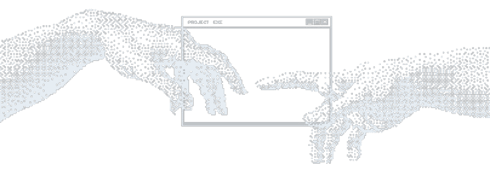

  

<h2 align="center">Hi 👋, I'm Sarvesh</h2>

<h4 align="center">Full-Stack Developer</h4>

<code>just ship it</code>

Building end-to-end web apps with clean backends, fast frontends and a terminal-first workflow.

---

<h2 align="center">🚀 About Me</h2>

<table>
<tr>
<td width="58%" valign="top">

**Sarvesh**, here — a final-year Computer Science student who loves building things end to end.

I build APIs with **Python**, **FastAPI** and **Django**, and interfaces with **React** and **Next.js**, all developed on **Linux** and shipped with **Docker**.

Currently going deeper into **cloud & DevOps**, experimenting with **AI/ML**, and sharpening my problem-solving with **Data Structures & Algorithms**.

My goal is simple: write clean code, ship things people actually use, and keep getting better at it.

</td>
<td width="42%" align="center">
  
</td>
</tr>
</table>

---

<h2 align="center">🤝 Connect</h2>

  
  &nbsp;
  

---

<h2 align="center">💻 Tech Stack</h2>

  
   
  

---

<h2 align="center">📈 Activity Graph</h2>

  

<picture>
  <source media="(prefers-color-scheme: dark)" srcset="https://raw.githubusercontent.com/SARVESH-GARIBE/SARVESH-GARIBE/output/github-snake-dark.svg" />
  <source media="(prefers-color-scheme: light)" srcset="https://raw.githubusercontent.com/SARVESH-GARIBE/SARVESH-GARIBE/output/github-snake.svg" />
  
</picture>
